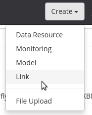
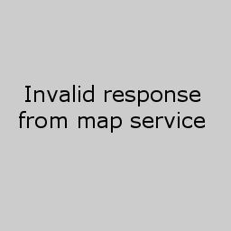

# UKCEH metadata catalogue

[](https://doi.org/10.5281/zenodo.14930462)

[Introduction for developers](docs/introduction.md)

## Installation

### Running the application

The recommended way to run the application is with Docker Compose, which starts all services
including nginx, Solr, the Spring Boot application, and the Vite build watcher:

```bash
# First run, or after changing the Dockerfile or entrypoint script:
docker compose up --build --watch

# Subsequent runs (reuses the built image and cached Gradle dependencies — much faster):
docker compose up --watch

# Watch mode — auto-rebuilds when build.gradle, libs.versions.toml, Dockerfile, or entrypoint-dev.sh change:
docker compose watch
```

Browse to http://localhost:8080/eidc/documents to see the catalogue populated with demo records.

Optional services can be included with profiles:

```bash
docker compose --profile hubbub up --build   # include Hubbub upload service
docker compose --profile legilo up --build   # include Legilo
docker compose --profile fuseki  up --build  # include Fuseki SPARQL
```

Local environment overrides can be placed in `override.env`.

## Project Structure

- **/datastore**  - Git-backed document store created at runtime (local development only; do not edit). The source records are in `/fixtures/datastore/REV-1/` — edit `.raw` and `.meta` files there to change the demo data that gets loaded on startup. `service-agreement/` holds a draft Service Agreement for record `001d1d47-65f3-4b67-8a19-61fafc21ecc9` (as `superadmin`, open the record and choose More ▸ Service agreement; there is no search for service agreements). Fixtures are copied in only when the `datastore` volume is first created, so to pick up new ones run `docker compose down`, `docker volume rm catalogue_datastore` (discarding local edits) and `docker compose up --build`
- **/docs**       - Documentation
- **/fixtures**   - Test data
- **/java**       - Standard `gradle` project which powers the server side of the catalogue
- **/solr**       - `Solr` web application, this handles the free-text indexing and searching of the application
- **/templates**  - `Freemarker` templates which are used by the `java` application for generating the different metadata views
- **/web**        - Location of the web component of the project, this is mainly `JavaScript` and `less` style sheets

## API
[API documentation](docs/api.md)

## Endpoints
[Endpoint documentation](docs/endpoints.md)

## Enabling different features
[Configure profiles](docs/profiles.md)

## Semantic (vector) search

Semantic search uses vector embeddings via Amazon Bedrock to find conceptually related records,
even when search terms don't match document keywords exactly.

Activate with the `vector-search` Spring profile and AWS Bedrock credentials:

```bash
# override.env
SPRING_PROFILES_ACTIVE=development,server-eidc,search-basic,cache,service-agreement,upload-simple,vector-search
AWS_ACCESS_KEY_ID=...
AWS_SECRET_ACCESS_KEY=...
AWS_REGION=eu-west-2
```

Once active, users with access see a **Semantic search** toggle below the search box. Alternatively,
add `?semantic=true` directly to any search URL:

```
GET /eidc/documents?term=freshwater+invertebrate+monitoring&semantic=true
```

**Access control:** restrict the toggle to a specific Crowd group by setting
`catalogue.semantic.group=GROUP_NAME` in `override.env`. Leave empty (default) to allow
all users.

**Embedding enrichment:** to include text from supporting PDF/Word/RTF documents in the
embedding, mount them into the container and set the location property:

```yaml
# docker-compose.yml catalogue service
volumes:
  - /host/path/supporting-docs:/var/ceh-catalogue/supporting-documents:ro
environment:
  CATALOGUE_SUPPORTING_DOCUMENTS_LOCATION: /var/ceh-catalogue/supporting-documents
```

Supporting documents are expected at `{location}/{documentId}/` (one subdirectory per record).
Up to 5 documents (4 000 chars each) are extracted per record. If the property is absent,
extraction is disabled and embeddings use metadata fields only.

Documents without embeddings (e.g. newly indexed before the first flush) are excluded from
semantic results but remain fully searchable via BM25. Embeddings are generated asynchronously
every 5 minutes (configurable via `catalogue.embedding.flush-delay`).

After changing `solr/documents/conf/managed-schema`, trigger a full reindex via the admin
`/index` endpoint so all documents receive vector embeddings.

See `docs/vector-search-mcp.md` for full technical details.

## MCP server

The MCP server exposes catalogue search to external LLMs (Claude Desktop, etc.) using the
Model Context Protocol over SSE.

Add `mcp-server` to `SPRING_PROFILES_ACTIVE`:

```bash
SPRING_PROFILES_ACTIVE=development,server-eidc,search-basic,cache,service-agreement,upload-simple,mcp-server
```

Available endpoint:
- `/mcp` — Streamable HTTP transport (the default since Spring AI 2.0; SSE is deprecated)

Available tools: `searchCatalogue`, `semanticSearch` (requires `vector-search` profile),
`getDocument`, `listCatalogues`.

## Usernames and Passwords

You will need to create a `secrets.env` file with the following. Ask one of the dev team for access to Keypass to retrieve the values. `JIRA_TOKEN` is a JIRA Personal Access Token generated for the `eidc_ingest` account (Profile → Personal Access Tokens in JIRA). `HUBBUB_TOKEN` and `LEGILO_TOKEN` are proxy personal access tokens for the `eidc_hubbub` account, one for each service (log in as `eidc_hubbub`, then `/sso/tokens`; see [Service tokens in staging and production](#service-tokens-in-staging-and-production)). The catalogue will not start if either is missing or blank. Against a local hubbub container any non-blank `HUBBUB_TOKEN` will do. `LEGILO_TOKEN` in `secrets.env` has no effect under `docker compose`: `docker-compose.yml` sets `LEGILO_TOKEN: local-dev-token` for the local legilo container, which checks no credentials, and a service's `environment` takes precedence over its `env_file`. It is only used when you point `LEGILO_URL` at a real legilo, and then you must also remove that line.

```
JIRA_TOKEN=
CROWD_PASSWORD=
DOI_PASSWORD=
HUBBUB_TOKEN=
LEGILO_TOKEN=
FUSEKI_PASSWORD=
```

### Service tokens in staging and production

The catalogue reaches hubbub and legilo through their SSO proxies, and authenticates with personal
access tokens (PATs) for the `eidc_hubbub` account, sent as `Authorization: Bearer`. There is one
token for each service, so that either can be revoked on its own. A PAT lasts at most 364 days,
so both have to be replaced every year.

| Environment | Tokens from | Kubernetes secret / keys | Env vars | Expires |
|---|---|---|---|---|
| staging | `https://catalogue.staging.ceh.ac.uk/sso/tokens` | `eidc/client-tokens` / `hubbub`, `legilo` | `HUBBUB_TOKEN`, `LEGILO_TOKEN` | **1 October 2027** |
| production | `https://catalogue.ceh.ac.uk/sso/tokens` | `eidc/client-tokens` / `hubbub`, `legilo` | `HUBBUB_TOKEN`, `LEGILO_TOKEN` | **1 October 2027** |

When a token expires, that proxy answers with `401`: uploads fail (hubbub) or keyword suggestions
fail (legilo). A missing or blank token stops the catalogue from starting.

**Rotate them by 1 September 2027.** In outline: log in as `eidc_hubbub`, create two new 364-day
tokens, seal them into `client-tokens.yaml`, restart `deployment/catalogue`, check each token's
**Last used** column, then revoke the old ones. The exact commands are in the cluster READMEs:
[staging](https://gitlab.ceh.ac.uk/infrastructure/k8s-clusters/k8s-eds-staging/-/blob/master/workloads/eidc/README.md#service-tokens) and
[production](https://gitlab.ceh.ac.uk/infrastructure/k8s-clusters/k8s-eds-prod/-/blob/main/workloads/eidc/README.md#service-tokens).

## Getting started

The catalogue requires a few tools:

- Git
- Docker
- Docker Compose

Java is not required locally — the application runs entirely inside Docker.

You will then need to log in to the Gitlab Docker Registry, nb. this uses your Gitlab username/password or token, not Crowd, if they're not the same, this might catch you out.

    $ docker login registry.gitlab.ceh.ac.uk

Having installed these you can build and start the full application with:

```bash
docker compose up --build   # first run
docker compose up           # subsequent runs (faster — reuses cached Gradle dependencies)
docker compose watch        # like `up`, but auto-rebuilds on Dockerfile/build file changes
```

The EIDC catalogue is then available at http://localhost:8080/eidc/documents.

### Intellij set-up

Make sure that you have the Lombok plugin installed, if not you can download it from `settings -> Plugins -> marketplace` and search for Lombok.
Check that annotation processing is enabled in `settings -> Build, Execution, Deployment -> compiler -> Annotation processors`.


### Developing JavaScript and CSS

The `web` service in Docker Compose runs the Vite build watcher (`npm run watch`), which rebuilds both the JavaScript and the stylesheets, automatically.
Any changes to `web/src/` or `web/scss/` are rebuilt within a few seconds — refresh the
browser to see the result; no container restart is needed.

```bash
# Run JS tests (single run), on the host: the web container has no browser to run them in
cd web && npm run test

# Lint:
cd web && npm run lint
```

### Test JavaScript using Vitest

      npm run test             # the specs, once
      npx vitest               # watching, rerunning what a change affects
      npm run test-coverage    # with the coverage report and floor, as CI runs them

The specs run on [Vitest](https://vitest.dev/) in a real browser: Chromium, driven by Playwright,
using the Chrome Puppeteer installs (`npx puppeteer browsers install chrome` in `web/` if it is
missing; CI uses its own chromium). They are found in each module in `web/src/` if you need to edit
or add new tests: for example, the tests for the editor module are in `web/src/editor/test/`.
Each imports what it uses from `vitest`; `web/src/test/support.js` fakes the server jQuery talks to.
The runner, and the coverage floor, are configured in `web/vitest.config.mjs`.

### Java

**Running tests:**

```bash
./gradlew :java:test
./gradlew :java:test --tests uk.ac.ceh.gateway.catalogue.search.SearchControllerTest
./gradlew :java:test --tests uk.ac.ceh.gateway.catalogue.search.SearchControllerTest.myTest
```

Run these on the host, including while `docker compose up` is running — the container keeps
its own Gradle project cache and Jena/datastore storage isolated from the host, so the two
don't lock-contend. Running Gradle via `docker compose exec catalogue ...` isn't supported:
most `@SpringBootTest` classes share the app's own storage locks with whatever the running
container is already doing, and will fail unpredictably.

After editing a `.java` file, run `./gradlew :java:compileJava` on the host — Spring DevTools
detects the new class files and restarts the application context in ~5–15s without a full
container restart.

Tests can also be run through IntelliJ using the standard run configurations.

### Spring profiles
Spring Profiles provide a way to segregate parts of your application configuration and make it only available in certain environments.
Any @Component or @Configuration can be marked with @Profile to limit when it is loaded.
The active profiles are set via the `SPRING_PROFILES_ACTIVE` environment variable in `docker-compose.yml` (and can be overridden in `docker-compose.override.yml` or `override.env`).
The catalogue contains the following Spring profiles:
##### development
The development profile runs code that is only available when developing such as the `DevelopmentUserStoreConfig.java` which makes testing code locally easier as it allows the user access to more user permissions.
##### upload-simple / upload-hubbub
Allows the user to upload their documents using `FileSystemStorageService.java` when `upload-simple` is active or the Hubbub API which `UploadService.java` interfaces with when `upload-hubbub` is active (enabled with the `-b` flag). Only one can be active. Under `docker compose` the upload profile comes from `UPLOAD_PROFILE` (default `upload-simple`); `upload-hubbub` needs the `hubbub` compose profile too, see [Developing Upload - Hubbub API](#developing-upload---hubbub-api).
##### keyword-suggestions
Enables the Legilo keyword suggestion service (enabled with the `-l` flag).
##### server-eidc / server-datalabs / server-inms
The server profile e.g. `server-eidc` decides which catalogue you will use and which documents that you will use with it. For example the EIDC catalogue will use Gemini documents.
##### search-basic / search-enhanced
Select which algorithm Solr uses to search for documents.
##### service-agreement
Allows the user to create online service agreements for datasets.
##### exports
Enables SPARQL/RDF export endpoints; requires Fuseki (enabled with the `-f` flag).
##### cache
Enables EHCache-based response caching. Active by default in development.
##### metrics
Creates the database for metric reporting.
Currently it supports two databases:
- SQLite (default; will be removed after PostgreSQL is thoroughly tested)
- PostgreSQL (enabled by setting `metrics.database.engine=postgres`; requires the docker compose profile: run `docker compose --profile metrics up` for local dev).

### Building the JavaScript and stylesheets
Vite builds both (`web/vite.config.mjs`) into `dist/`, laid out as it is served under `/static`:
`scripts/`, `css/` and `assets/` (the images and fonts the stylesheets use). Every file name carries a
hash of its content, so browsers may cache them for a year; `dist/manifest.json` lists each entry's
files, and the templates find them through it (`assets.files("main")`). The scripts are ES modules,
loaded with `<script type="module">`. The specs (`vitest.config.mjs`) share the build's plugins, so
they run the code as the pages do. In the web directory run

    npm run build-dev   # one-off development build
    npm run watch       # watch and rebuild on changes (docker compose runs this)
    npm run build       # production build

## Adding new document types to the catalogue

See [Adding a new document type](docs/newDocumentType.md) for step-by-step instructions.

If you need to add a new document type to the catalogue like `GeminiDocument.java`,
extend your new class with `AbstractMetadataDocument.java` and configure it in the following classes:
`CatalogueMediaTypes.java`, `CatalogueServiceConfig.java`, `ServicesConfig.java` and `WebConfig.java`.
For an example of how to do this look at how the GeminiDocuments are configured in each of these classes.

## Multiple Catalogues

[Create a new catalogue](docs/new-catalogue.md).

Multiple catalogues are supported by this software.

A catalogue has its own:
- search page
- style
- editor and publisher groups
- metadata records
- document types

## Catalogue Content

A catalogue can reuse existing metadata content by linking to public metadata in
another catalogue using the Link document type.



## Remote-User

The catalogue is designed to sit behind a **Security Proxy**
see [RequestHeaderAuthenticationFilter](http://docs.spring.io/autorepo/docs/spring-security/3.2.0.RELEASE/apidocs/org/springframework/security/web/authentication/preauth/RequestHeaderAuthenticationFilter.html) which acts as the authentication source for the application. Therefore, the catalogue will respond to the `Remote-User` header and handle requests as the specified user.

To simplify development, the `DevelopmentUserStoreConfig` is applied by default. This creates some dummy users in various different groups which you can masquerade as using the Dev Bar at the top of the page.

Other users are configured in [DevelopmentUserStoreConfig](java/src/main/java/uk/ac/ceh/gateway/catalogue/config/DevelopmentUserStoreConfig.java) for the different catalogues.

## Developing Upload - Hubbub API
Getting everything running

Start with the Hubbub compose profile and the `upload-hubbub` Spring profile, which replaces
`upload-simple`, and turn on the [data preview](#data-preview), which is off by default (put
`COMPOSE_PROFILES=hubbub`, `UPLOAD_PROFILE=upload-hubbub` and `DATA_PREVIEW_ENABLED=true` in `.env`
to make them the default):

```bash
UPLOAD_PROFILE=upload-hubbub DATA_PREVIEW_ENABLED=true docker compose --profile hubbub up --build
```
### Populate the database

A new `hubbub-db` container creates the schema and status rows from `fixtures/hubbub/init`, and
registers the fixture files the data preview lists (`seed_files.sql`). Postgres runs these only on an
empty data directory, so for a database created before them run
`UPLOAD_PROFILE=upload-hubbub docker compose --profile hubbub up -V hubbub-db` (`-V` starts it with a
fresh volume, discarding its data). For the upload page fixtures, import `fixtures/upload/file.csv`
into the `file` table.

### Data preview

The Data Preview section of a dataset record page lists the record's files through Hubbub and reads
them from `fixtures/upload/eidchub` and `fixtures/upload/supporting-documents`, mounted read-only
into the catalogue, so it needs the Hubbub set-up above. It appears only for an openly accessible
record: publicly viewable, with an access limitation of `availability` `Available` and an open-access
URI (`http://vocab.nerc.ac.uk/collection/N07/current/UNRS/`). No fixture record is open as shipped;
`2d023ce9-6dbe-4b4f-a0cd-34768e1455ae` has the files, so give it that access limitation (and a
`download` online resource for the download links) to see the preview.

### Hubbub Javascript development

1. Run `npm run test-server` to recompile `hubbub.budnle.js` on code changes and run tests.
   1. `npm run watch` if you just want the code to recompile on changes
2. You will need access to the EIDCHELP Jira project to run the app.
3. The [Busy Buzy Bumblebees](http://localhost:8080/upload/c88921ba-f871-44c3-9339-51c5bee4024a) upload page has a [Jira issue](https://jira.ceh.ac.uk/browse/EIDCHELP-52451) in the EIDCHELP project
4. Set the requests header `remote-user: uploader` to see page as a data depositor.
   Or `remote-user: superadmin` to see it as data centre staff.

## Map Viewer

### TO DO - The Map Viewer was removed during the Catalogue upgrade, create a new one using Leaflet .
### The following notes are left over from the old map viewer which may come in use which is why I have left them in.


All requests for maps go through our catalogue api as TMS coordinates
(i.e. z, x, y). When a map request comes in, the catalogue api transforms
the z, x, y coordinates into a wms GetMap request in the EPSG:3857 projection
system. This is the projection system which is used by Google Maps style web
mapping applications.

The Catalogue api will gracefully handle certain upstream mapping failures. These failures will be represented as images so that they can be displayed by the normal mapping application.

Below are the images which are displayed and there meaning:

### Legend not found


Displayed when a Legend image is requested but one has not been specified in the GetCapabilities

### Upstream Failure


The call to the server failed for some unspecified reason, this may be because the connection failed.

### Invalid response


The upstream service returned some content, but it was not in the format which was expected. It maybe that the upstream service replied with an error message rather than an image.

### Invalid Resource


The wms get capabilities returned a malformed reference to either a GetLegend or GetMap url. This can happen if you are using a buggy web map server or a corrupt external get capabilities.


## Logging level during development

The logging level of individual components can be controlled by adding them to the service's environment in a `docker-compose.override.yml`, like the following:

```yaml
services:
  catalogue:
    environment:
      - LOGGING_LEVEL_UK_AC_CEH_CATALOGUE_GEMINI_GEOMETRY=DEBUG
```
